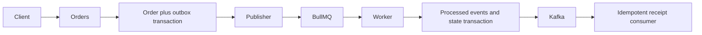

# Event-Driven Orders

[](https://github.com/yashybm30/event-driven-orders/actions/workflows/ci.yml)

An independently runnable portfolio project demonstrating tenant/user-scoped order api with server-authoritative sku prices.

## Implemented behavior

- Tenant/user-scoped order API with server-authoritative SKU prices
- Transactional PostgreSQL order/outbox writes and conflict-detecting idempotency keys
- BullMQ confirmation workers with bounded exponential retries
- Persistent processed-event deduplication and dead-letter records
- Optional Kafka-compatible order-confirmed producer and receipt consumer

## Architecture



## Requirements and setup

Node.js 24 and npm. Docker Engine with Compose v2 is needed for local databases/queues. Native browser scraping also requires Chromium. Exact dependencies and reproducible versions are in package.json/package-lock.json.

```bash
npm ci
npm run check
```

```bash
cp .env.example .env
# Edit the environment before starting; use random independent signing secrets.
docker compose --env-file .env up --build -d
```

Run one stack at a time because localhost development ports overlap. For native execution, run `npm run build`, start the documented dependencies, apply migrations where applicable, then `npm start`. Node reads `.env` for the start and SQL migration scripts; Vitest requires exported test environment variables. Bash examples use `NAME=value command`; PowerShell uses `$env:NAME='value'` before the command.

PostgreSQL migrations: `npm run db:migrate` after `npm run build`. `DATABASE_URL` selects the database; optional `PGSCHEMA` selects an isolated SQL schema. Migrations create and version the initial schema. Use a separate DDL-capable migration connection and a restricted runtime role in production. Compose uses development-only credentials and must not be exposed as production database configuration.

## Configuration

- `PORT`: HTTP port (default 3000).
- `JWT_SECRET`: at least 48 random characters; match the trusted issuer when using auth-service tokens.
- `JWT_ISSUER` / `JWT_AUDIENCE`: default `portfolio-auth` / `portfolio-api`.
- `CORS_ORIGIN`: comma-separated browser origins, deny cross-origin by default.
- `REDIS_URL`: local Redis connection where applicable.
- `DATABASE_URL`: PostgreSQL connection, with credentials injected outside source control.
- `PGSCHEMA`: SQL schema name, default `public`; validated as a bounded identifier.
- `KAFKA_BROKERS`, `KAFKA_GROUP`: optional broker list and consumer group.
- `QUEUE_PREFIX`: queue namespace; `FAIL_FIRST_ATTEMPTS`: local retry experiment only.

## Usage and contracts

```bash
curl -X POST http://localhost:3000/v1/orders \
 -H "Authorization: Bearer $ACCESS_TOKEN" -H 'Idempotency-Key: demo-order-001' \
 -H 'Content-Type: application/json' -d '{"items":[{"sku":"book","quantity":2}]}'
```

Prices are minor units: book=1500, keyboard=7500, monitor=25000. Caller-provided prices are rejected. Reusing a tenant-scoped idempotency key with changed items returns 409. GET `/v1/orders` and GET `/v1/orders/:id` are scoped to the caller and tenant. Admin GET `/v1/orders/dead-letters` lists only its tenant's exhausted jobs.

The publisher locks outbox rows with `SKIP LOCKED` and uses the outbox UUID as the BullMQ job ID. Queue delivery is at least once; the worker records the processed event and state change in one SQL transaction. Confirmation creates another outbox event. Set `KAFKA_BROKERS` for a Kafka-compatible broker; when absent, confirmation events remain in the outbox rather than being discarded. Compose uses Redpanda. `FAIL_FIRST_ATTEMPTS` is a local failure-experiment setting, default 0. Failed jobs remain in BullMQ and exhausted failures are also recorded in SQL; admin POST `/v1/orders/dead-letters/:eventId/retry` requeues a failed job and retains its recovery audit fields.

### Authentication and health

Authenticated HTTP examples use `Authorization: Bearer $ACCESS_TOKEN`. Obtain a correctly scoped token from your trusted issuer or the portfolio auth service using the same signing/issuer/audience settings. No production debug token endpoint is exposed. GET `/health/live` verifies the process; GET `/health/ready` checks the project's primary dependencies. `/docs` exposes route documentation; request examples here define the detailed contracts.

## Validation

```bash
npm run check
npm run test:integration  # requires actual local dependencies, where a suite exists
```

Unit tests never imply integration success. Integration suites use disposable namespaces and test signing keys; never point them at production. Tests import compiled application modules to preserve NestJS decorator metadata. See Actions for the current hosted status. External provider calls and cloud deployments are not part of local acceptance.

## Deployment and operations

The Dockerfile uses a separate build stage and a non-root runtime. Start dependencies and migrations before the application. Compose is a local development setup. For GCP/GKE or another cloud, publish a reviewed image, inject secrets using the platform secret manager, configure private dependency connectivity, health probes and resource limits, and verify graceful shutdown. No paid cloud resource is created by this repository.

## Security and trade-offs

Bearer identity is verified with an explicit JWT algorithm, issuer, audience and structured claims. Tenant IDs come from verified tokens, not headers. New services validate access-token expiry but do not introspect the authentication service for immediate token revocation; use short-lived tokens or add an introspection boundary where required. Limits and permission checks are documented per endpoint. Use TLS, workload credentials, restricted networks, backups, request quotas and least-privilege runtime roles before real deployment.

## Known limitations

No payment, stock reservation or shipping integration is implemented. Delivery is at least once, not distributed exactly once. Kafka is optional and its broker-enabled mode must be verified separately from the default queue integration suite. Failed jobs require an authorized tenant-admin redrive; processed-event deduplication still applies.

## Roadmap

Expand failure-mode coverage, validate external integrations in a staging account, add deployment-specific telemetry and retention policy, and review action/dependency updates regularly. Features described above are implemented; this roadmap is not a completion claim.

MIT licensed. See CONTRIBUTING.md and SECURITY.md.

### Standalone development identities

For a disposable local setup without a separate identity server, set the same random `JWT_SECRET` as the API and run `npm run token:dev -- <subject-uuid> <tenant-uuid> <admin-or-member>`. The CLI prints a 15-minute token; it is disabled when `NODE_ENV=production`. Keep it in your shell session, never commit it or paste it into issues. This is a local development utility, not a public login endpoint. Production must use a trusted identity issuer.
